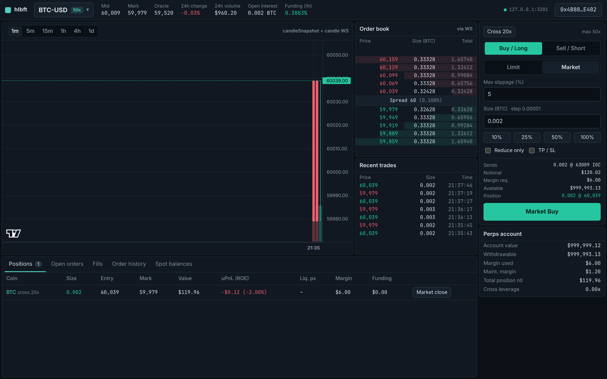

# hlbft trading UI

A small web trading terminal for a local hlbft network. It talks to the node's
Hyperliquid-compatible API (`/info`, `/exchange`, WebSocket `/ws`) through
[`@nktkas/hyperliquid`](https://github.com/nktkas/hyperliquid) 0.33.3, and signs
as **testnet**, as the local chain expects (D9).



What you get:

* **Markets**: the perps from `metaAndAssetCtxs` (BTC, ETH, SOL, …) and the spot pairs from `spotMetaAndAssetCtxs` (PURR/USDC).
  The header shows mid, mark, oracle, 24h change/volume, open interest and funding, updated live over `activeAssetCtx`.
* **Order book** (`l2Book` over WS; HTTP polling while the socket is down) and **recent trades** (`recentTrades` + `trades`).
  Click a book level to copy its price into the order form.
* **Chart**: candles from `candleSnapshot` + `candle` WS (lightweight-charts), 1m–1d.
* **Order entry**: limit (Gtc / Ioc / Alo), market (IOC at mid ± slippage, as the SDK examples do), reduce-only,
  optional TP/SL (market triggers sent with `normalTpsl` grouping), leverage and cross/isolated (`updateLeverage`).
  Sizes are truncated to `szDecimals` and prices rounded to 5 significant figures (SDK `formatSize` / `formatPrice`).
  The form shows the exact price and size it will send.
* **Account**: margin summary, positions (with a market-close button), open orders (cancel, cancel all), fills,
  order history and spot balances. Live over `clearinghouseState`, `openOrders`, `userFills` and `orderUpdates`
  subscriptions, with a 4 s HTTP refresh as backup (spot balances and history are HTTP only).
* **Errors**: every rejected action shows the server's error string in a red toast that stays until you close it,
  e.g. `order 0: Post only order would have immediately matched, bbo was 59979@60039`.

## Prerequisites

* Node 22 (Node 20 also works) and npm.
* A running localnet. From the repo root: `scripts/localnet.sh dev`. That starts the API on http://127.0.0.1:3001,
  funds the `sdk_example` account and seeds liquidity.

## Run

```bash
cd frontend
npm install
npm run dev        # http://localhost:5173
```

`npm run build` type-checks and writes a static bundle to `dist/`, and `npm run preview` serves it.

## Load a funded account

Click **Connect key** in the top right corner:

* **Funded localnet accounts**: the dev server reads `../run/localnet/accounts.json`, the file `localnet.sh` writes.
  Pick `sdk_example`, which is the main funded account (1,000,000 USDC perps and 100,000 USDC + 80,000 PURR spot), then **Apply**.
  If your localnet lives elsewhere, start the dev server with `LOCALNET_ACCOUNTS=/path/to/accounts.json npm run dev`.
  You can also use **Load accounts.json…** to choose the file directly.
* Or paste any private key.

The key is kept in the page's memory. It is saved to this browser's localStorage only if you tick
"Remember key". The only place it is used is to sign the actions you submit. This is a dev tool, so never paste a key that holds real funds.

## Point it at another node

Change **API base URL** in the settings. The WebSocket URL is derived from it as `ws://host:port/ws`. You can also:

* open `http://localhost:5173/?api=http://127.0.0.1:3002` to pick a URL for that tab, or
* set the default when building or running: `VITE_API_URL=http://10.0.0.5:3001 npm run dev`.

CORS on the node is permissive, so the UI can be served from anywhere.

## End-to-end test

```bash
npm run e2e                                    # against http://127.0.0.1:3001
HLBFT_API=http://127.0.0.1:3201 npm run e2e    # another port
E2E_SCREENSHOTS=1 npm run e2e                  # also refresh docs/*.png
```

The test starts its own Vite dev server on a free port and drives headless Chromium with Playwright. In order, it:

1. loads `sdk_example` from the account picker;
2. waits for the BTC book and the WebSocket;
3. checks that a crossing ALO order is rejected and the server's error string appears;
4. places a resting limit buy and sees it in open orders;
5. cancels it;
6. places a market buy, sees it fill and sees a BTC position;
7. closes the position with the close button.

If the test fails, a screenshot is written to `e2e/out/failure.png`.

Other env vars: `HLBFT_KEY` (use this key instead of the picker), `HLBFT_ACCOUNTS` (path to accounts.json),
`E2E_UI_URL` (test a UI that is already running), `E2E_HEADED=1`.

Playwright needs a Chromium build. On a fresh machine run `npx playwright install chromium` once.

## Known limitations

* The node has no `spotState` WS channel, so spot balances are polled. It has no `webData3`, so the UI uses the
  separate per-user channels instead.
* Candles exist only for minutes with trades, so a freshly seeded chain shows an empty chart until the first fill.
* TP/SL is offered only together with a new order (`normalTpsl`). You can't attach TP/SL to an existing position (`positionTpsl`)
  or modify an order from the UI. Cancel the order and place a new one instead.
* Market close uses mid ± 5% as the IOC limit. On a thin book the close can be partial; press the button again to close the rest.
* There is no agent/API-wallet flow: the pasted key signs everything directly.
* The layout targets laptop/desktop widths (≥ 1100 px).
